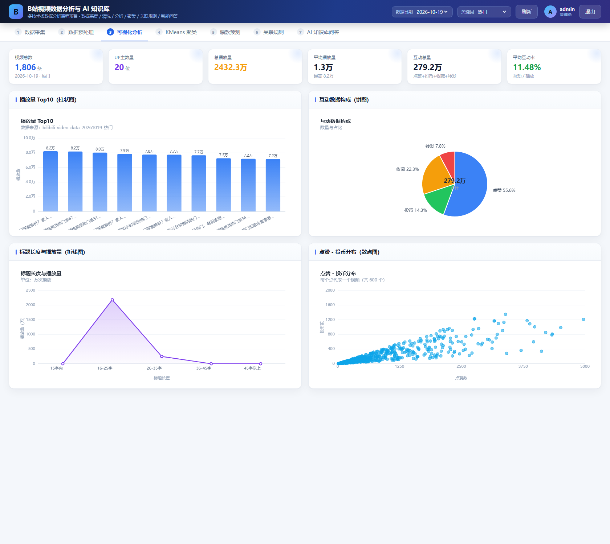
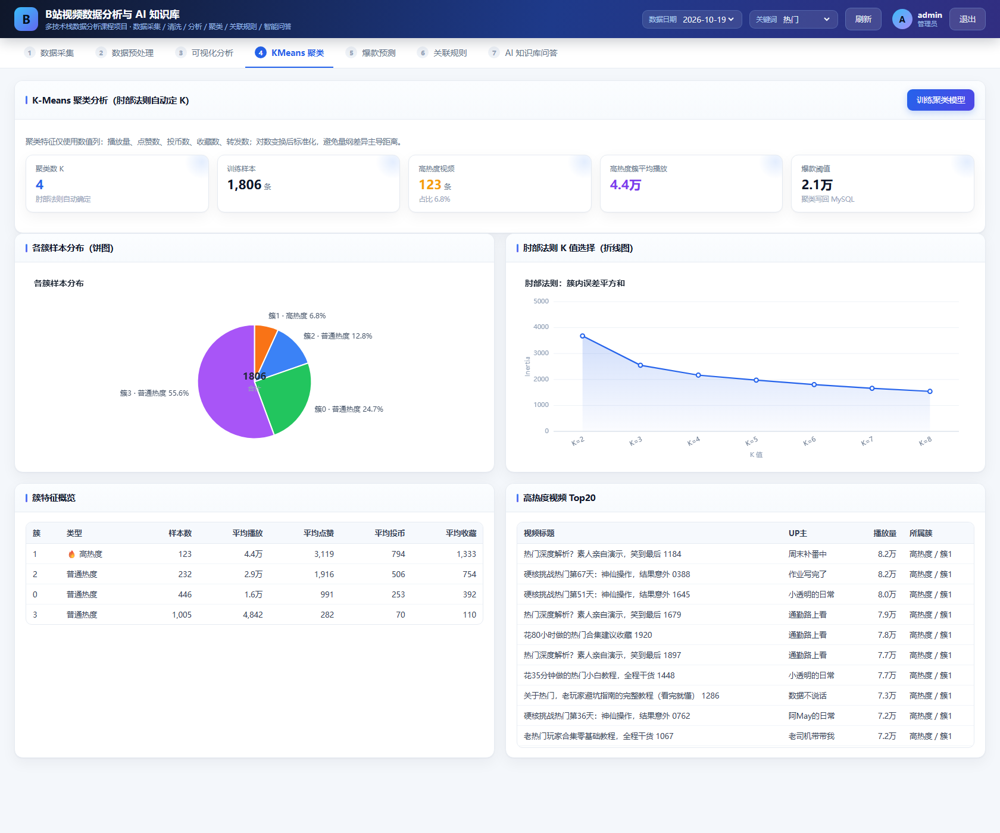
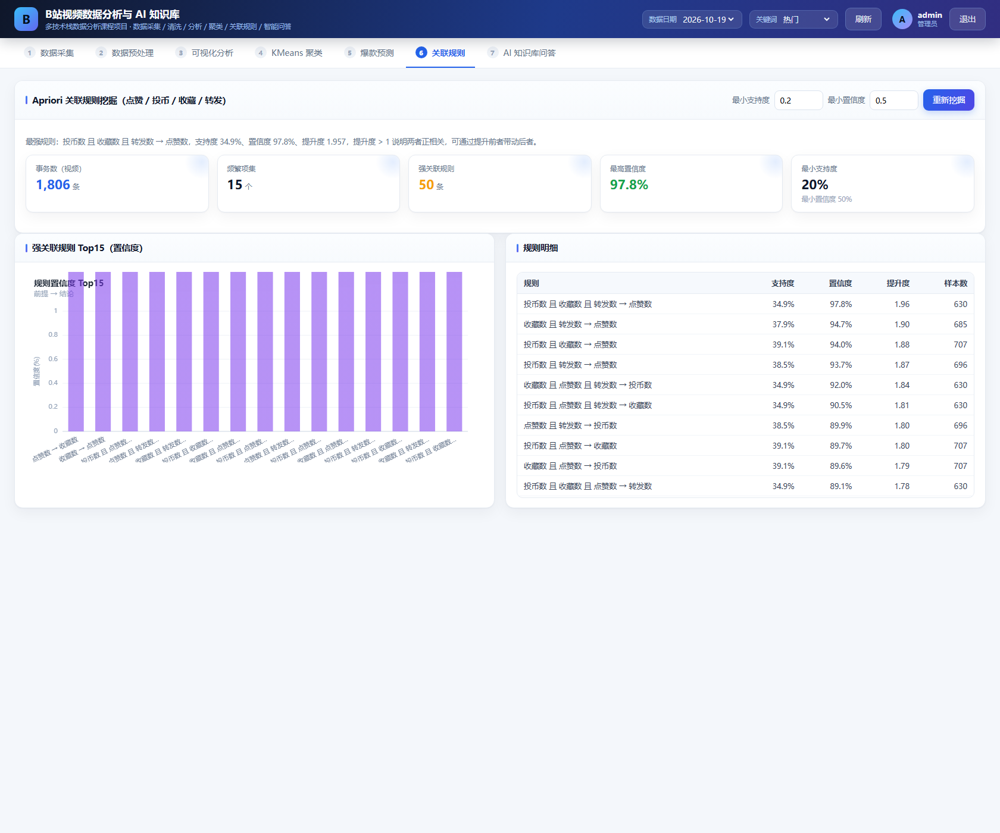
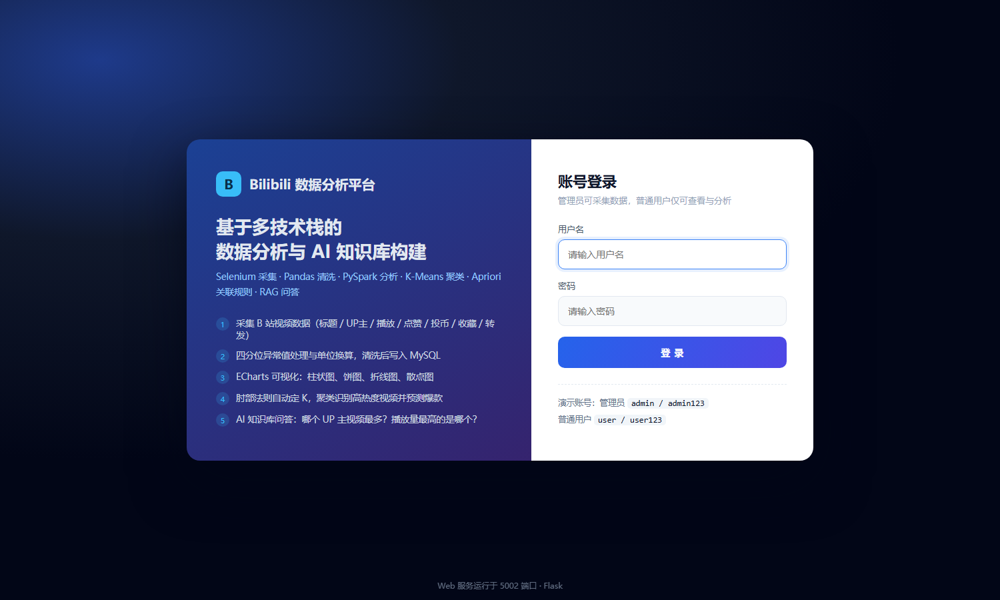
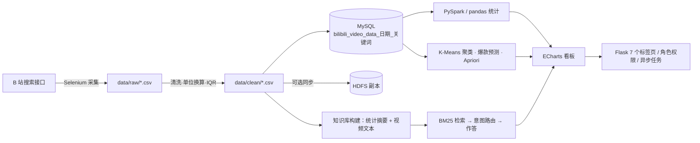

# B 站视频大数据分析与 AI 知识库问答平台

一个「采集 → 清洗 → 统计 → 聚类 → 预测 → 关联规则 → 自然语言问答」全链路打通的 B 站视频数据分析系统：用 **Flask** 做 Web 服务、**MySQL** 存结构化数据、**PySpark / pandas** 做统计、**scikit-learn** 做聚类与预测、**mlxtend Apriori** 挖关联规则、**ECharts** 出图，最上面再叠一层**检索增强（RAG）问答** —— 直接用中文问数据，例如「播放量最高的视频是哪个」。

> 示例批次：`2026-10-19 · 关键词「热门」· 1,806 条视频 / 13 个字段`；支持按「批次日期 + 关键词」管理多批数据集。

---

## 界面截图

### 可视化分析看板



6 张指标卡（视频总数 / UP 主数量 / 总播放量 / 平均播放量 / 互动总量 / 平均互动率）+ 4 类图表：播放量 Top10 柱状、互动数据构成饼图、标题长度与播放量折线、点赞-投币分布散点。

### K-Means 聚类（肘部法则自动定 K）



聚类数 **K=4**、训练样本 1,806 条、高热度视频 **123 条（6.8%）**、高热度簇平均播放 **4.4 万**、爆款阈值 **2.1 万**；右侧为「簇内误差平方和」随 K 变化的肘部曲线，下方是各簇特征概览与高热度 Top20 明细。

### Apriori 关联规则挖掘



事务数 1,806 条、频繁项集 15 个、强关联规则 50 条、最高置信度 **97.8%**；最强规则 `投币数 & 收藏数 & 转发数 → 点赞数`（支持度 34.9%、置信度 97.8%、提升度 1.957）。

### 登录与角色权限



管理员可采集 / 清洗 / 训练，普通用户只读；所有写操作都以异步任务 + 轮询进度的方式执行，避免长任务卡住页面。

---

## 关键数据（示例批次实测）

| 指标 | 数值 |
|---|---|
| 视频条数 | 1,806 条（单批上限 2,000） |
| UP 主数量 | 20 位 |
| 总播放量 | 2,432.3 万 |
| 平均播放量 | 1.3 万（最高 8.2 万） |
| 互动总量（赞+币+藏+转） | 279.2 万 |
| 平均互动率（互动/播放） | 11.48% |
| 聚类结果 | K=4；高热度簇 123 条（6.8%），簇均播放 4.4 万 |
| 关联规则 | 频繁项集 15 个 → 强规则 50 条，最高置信度 97.8% |

---

## 七个功能模块

| # | 模块 | 能做什么 | 关键实现 |
|---|---|---|---|
| 1 | 数据采集 | Selenium 驱动 Headless Chrome 调 B 站搜索接口，多排序去重补量、随机延时限速、`--demo` 兜底 | `pachong.py` |
| 2 | 数据预处理 | 缺失值填充、`万/亿` 单位换算、IQR 四分位异常值处理、标题清洗、URL 去重，整表写入 MySQL | `preprocessing.py` |
| 3 | 统计分析 | 分区分布 / UP 主贡献 / 时长分布 / 互动指标四类统计，PySpark 与 pandas 双实现 | `spark_analysis.py` |
| 4 | 聚类与挖掘 | K-Means（肘部法则定 K）+ 爆款预测 + Apriori 关联规则 | `machine_kmeans.py` |
| 5 | 爆款预测 | 输入互动指标，输出是否爆款与概率，并给出「差距在哪」的建议话术 | `machine_kmeans.py` |
| 6 | AI 问答 | 知识库 = 结构化统计摘要 + 视频文本两段；BM25 召回 + 意图路由 + 三级降级生成 | `AI_Knowledge.py` |
| 7 | Web 服务 | 登录鉴权、7 个标签页、ECharts 可视化、问答历史 | `app.py` + `templates/` + `static/` |

---

## 架构与数据流



要点：**统计与挖掘都从 MySQL 的批次表出发**（一次清洗多处复用），问答侧则直接读清洗后的 CSV 建知识库 —— 两条链路互不阻塞；批次的切换只改「日期 + 关键词」两个参数。

---

## 技术栈

- **后端**：Python 3.11+、Flask、MySQL 8（`mysql-connector-python`）
- **数据处理**：pandas、numpy；**PySpark 3.3**（可选，未安装时自动降级 pandas，口径一致）
- **机器学习**：scikit-learn（StandardScaler + KMeans + RandomForest）、mlxtend（Apriori、association_rules）
- **采集**：Selenium + Headless Chrome
- **前端**：原生 JS + ECharts 5 + 离线轻量图表兜底
- **检索问答**：jieba 分词 + 自实现 BM25 + 意图路由；（可选）LangChain + Ollama 本地大模型

---

## 四段核心代码

### 1. 离线可用的 BM25：只要有 CSV 就能问答

系统不强依赖大模型：LangChain 装了就走上层检索器，没装就走自带的 BM25（`k1=1.5, b=0.75`），单词级 IDF 加权 + 长度归一化，另外对「聚合类问题」给统计摘要文档加 1.8 倍权重，保证「谁播放量最高」这类问题精准命中。

```python
def _bm25_retrieve(question: str, docs: list, top_k: int = RAG_TOP_K) -> list:
    """内置 BM25（k1=1.5, b=0.75）—— 没有 LangChain 也能检索。"""
    q = _tokens(question)
    tokenized = [_tokens(d["text"]) for d in docs]
    avgdl = sum(len(t) for t in tokenized) / len(tokenized) or 1.0
    df_counter = Counter()
    for toks in tokenized:
        df_counter.update(set(toks))
    n, k1, b = len(docs), 1.5, 0.75
    agg = any(w in str(question).lower() for w in _AGG_HINT)
    scores = []
    for idx, toks in enumerate(tokenized):
        tf = Counter(toks)
        score = 0.0
        for term in q:
            if not tf.get(term):
                continue
            idf = math.log(1 + (n - df_counter[term] + 0.5) / (df_counter[term] + 0.5))
            score += idf * tf[term] * (k1 + 1) / (
                tf[term] + k1 * (1 - b + b * len(toks) / avgdl))
        if score > 0:
            # 聚合类问题让统计文档靠前（UP主排行/播放排行/互动排行/概况）
            if agg and str(docs[idx].get("id", "")).startswith("-"):
                score *= 1.8
            scores.append((score, idx))
    scores.sort(reverse=True)
    return [dict(docs[i], score=round(s, 3)) for s, i in scores[:top_k]]
```

### 2. 肘部法则不靠肉眼看：用几何距离自动定 K

把 K–inertia 曲线的首尾连成直线，取「离直线最远」的点作为拐点 —— 比手工截取时间省事，也避免 K 值随批次波动。

```python
def _choose_k(elbow: list) -> int:
    """肘部法则：把首尾连成直线，取离直线最远的点作为拐点。"""
    if not elbow:
        return 3
    if len(elbow) <= 2:
        return int(elbow[0]["k"])
    ks = np.array([e["k"] for e in elbow], dtype=float)
    ys = np.array([e["inertia"] for e in elbow], dtype=float)
    x1, y1, x2, y2 = ks[0], ys[0], ks[-1], ys[-1]
    denom = np.hypot(y2 - y1, x2 - x1) or 1.0
    dist = np.abs((y2 - y1) * ks - (x2 - x1) * ys + x2 * y1 - y2 * x1) / denom
    return int(ks[int(np.argmax(dist))])
```

### 3. 关联规则先离散化：把连续指标压成 0/1 事务

Apriori 只认「事务里有没有这个项」，所以先把点赞/投币/收藏/转发按**中位数**二值化（高于中位数记为「有该行为」），再用 `max_len=4` 控住项集规模，按置信度排序取前 60 条。

```python
items = [c for c in APRIORI_ITEMS if c in df.columns]
basket = pd.DataFrame(index=df.index)
for col in items:
    basket[col] = (df[col] > df[col].median()).astype(int)

freq = apriori(basket.astype(bool), min_support=min_support, use_colnames=True, max_len=4)
freq["length"] = freq["itemsets"].apply(len)
rules = association_rules(freq, metric="confidence", min_threshold=min_confidence)
rules = rules.sort_values(["confidence", "lift"], ascending=False).head(60)
```

### 4. 生成端三级降级：环境变了不用改代码

| 模式 | 触发条件 | 效果 |
|---|---|---|
| `langchain` | 装了 `langchain` + `langchain-ollama` | LangChain 链 + Ollama 本地模型生成 |
| `ollama` | 只有 Ollama 服务在跑 | 直接 POST `/api/generate` |
| `offline-rag` | 都没有（默认） | 检索结果 + 规则化抽取作答，**无需联网、无需模型** |

`/api/meta` 会把当前生效的模式回给前端，界面据此显示「问答引擎」状态 —— 换机器、断网演示都不会白屏。

---

## 工程上的几个难点

1. **多排序去重补量**：单次搜索接口返回量有限，且结果有重复；改成多排序参数轮换 + URL 级去重 + 条数不足时二次补采，才凑够一批 2,000 条。
2. **脏数据的三类形态**：播放量是「8.2万」这种中文单位、互动字段存在空值、标题里混入话题标签；分别用单位换算、填充 0、正则清洗处理，异常值用 IQR 而不是直接删。
3. **聚合问题的检索偏置**：纯 BM25 会被高频词带偏，问「播放最高」却命中一堆视频标题；解法是额外注入若干「统计摘要文档」，并在意图为聚合时给它们加权。
4. **长任务不能阻塞页面**：采集/清洗/训练都跑成后台线程任务，前端拿 `job_id` 轮询 `/api/job/<id>`，失败也有明确的错误信息回显。
5. **无外网也能演示**：ECharts 做了本地 `echarts-lite.js` 兜底、问答走 `offline-rag`、PySpark 缺失时自动退化为 pandas。

---

## 仓库说明

本仓库为**项目展示**：包含架构说明、界面截图、关键指标与核心代码片段。

完整的 7 个模块源码（`pachong.py` / `preprocessing.py` / `spark_analysis.py` / `machine_kmeans.py` / `AI_Knowledge.py` / `app.py` + `templates/` + `static/`）保留在私有仓库中，如需查看请联系我。

## 数据与合规

数据通过 B 站公开搜索页采集，仅用于课程实验与技术演示；采集脚本遵守站点条款、默认随机延时 2.5~5.0 秒，不含任何用户隐私信息。仓库中的截图数据来自 2026-10-19 批次。